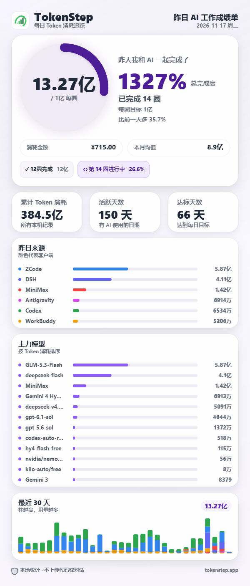
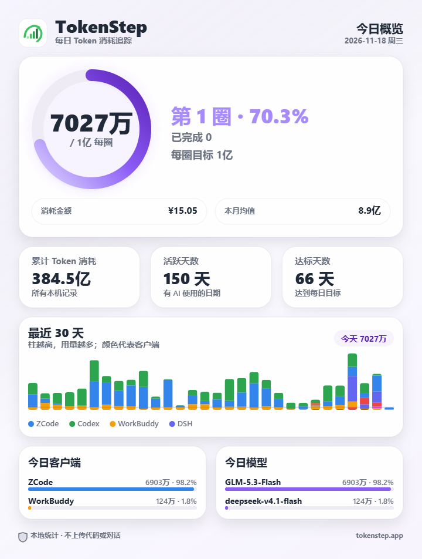
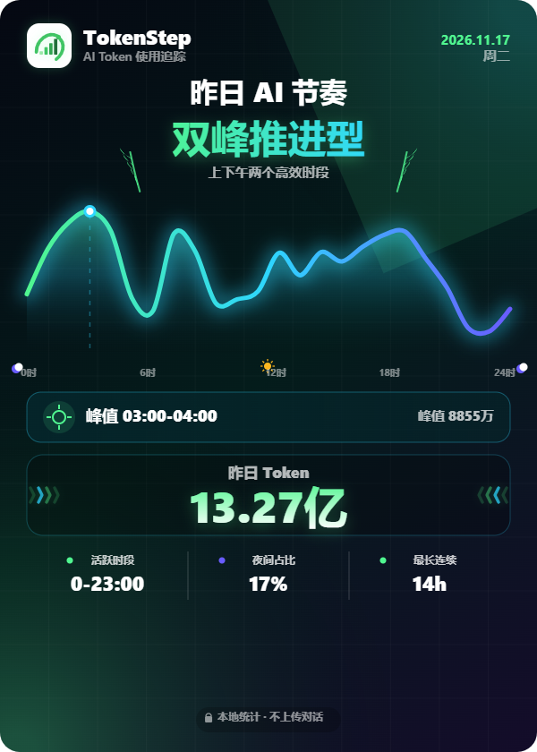

# TokenStep for Windows

**像记录步数一样，记录你每天的 AI Token 消耗。**

AI 时代，每个人都在和 Agent 一起工作。

但我们很少知道：今天到底用了多少 AI？有没有比昨天更进一步？

TokenStep 是一个 Windows 桌面应用，用来本地统计你在 Codex、Claude Code 等 AI 编程工具里的 Token 消耗，并把它变成一个像健身圆环一样的每日目标。

默认目标是：**每天 1 亿 Token**。

当你超过目标，圆环会进入下一圈。用得越多，颜色越深。

它不是为了严肃比较，而是让你直观看到：今天你和 AI 一起走了多远。

> 本版本是 macOS 版 TokenStep 的 Windows 移植版，原作者为 [@黄叔](https://github.com/Backtthefuture)。MIT 许可证。原项目地址：https://github.com/Backtthefuture/TokenStep

## 立即下载

下载最新版安装包，双击运行即可：

[下载 TokenStep for Windows 最新版](https://github.com/canyexuanfan/TokenStep-Windows/releases/latest)

也可以从 Release 页面查看所有版本：

[GitHub Releases](https://github.com/canyexuanfan/TokenStep-Windows/releases)

安装包已使用自签名证书签名。首次运行时 Windows SmartScreen 可能会提示「已保护你的电脑」，点击「更多信息 → 仍要运行」即可，这是自签名证书的正常现象。

如果你更偏好免安装版，也可以直接下载 `TokenStep_vX.X.X.exe`，双击运行，无需安装。

## TokenStep 适合谁？

TokenStep 适合这些人：

- 每天使用 Codex / Claude Code 写代码的人
- 用 AI Agent 做内容、开发、研究、自动化的人
- 想知道自己每天到底消耗了多少 AI Token 的人
- 把 AI 当成生产力基础设施，而不是偶尔试用工具的人

以前我们看步数，知道自己今天有没有动起来。

现在我们看 Token 消耗，知道自己今天有没有真正用 AI 推进工作。

## 它能做什么？

- 系统托盘常驻，后台运行，实时统计今日 Token 消耗和进度圆环。
- 点击托盘图标打开主窗口。
- 仪表盘：今日、历史、统计、隐私、设置。
- 超过 1 亿后自动进入第 2 圈、第 3 圈。
- 最近 30 天 Token 使用趋势（按客户端分色堆叠柱图）。
- 按客户端、按模型查看用量统计。
- 粗略估算 Token 消耗金额。
- 每日目标可设置，默认每天一个亿。
- 自动刷新，默认 1 分钟。
- 多种主题色，圆环、活动墙和按钮会一起变化。
- 一键截图分享当前页面。
- 订阅额度卡 8 家：Codex（5 小时 / 7 天窗口）、Claude Code、Cursor、GLM、Kimi、Grok、WorkBuddy、Antigravity（各家开关见设置 → 订阅额度提供商；未登录或无订阅时如实显示原因）。
- 三语界面：简体中文 / English / 繁體中文，切换立即生效。
- 自动检查更新，发现新版后可一键安装。
- 本地数据存放在 `%APPDATA%\TokenStep`，不上传任何内容。

## 界面一览

**每日战绩分享卡**（自动圈数 + 达标天数 + 来源/模型分解 + 30 天趋势）：



**今日概览**（圆环进度 + 按客户端分色的 30 天柱图 + 客户端/模型分布）：



**昨日节奏分享卡**（24 小时用量曲线 + 类型判定）：



## 当前支持（16 个数据源）

所有采集均为**被动读取**本机文件 / 数据库：不改工具配置、无卸载残留、数据不出本机。

### 专属采集器（9 个，逐客户端实现）

| 客户端 | 数据源 | 精度口径 |
|---|---|---|
| Codex | `~/.codex` SQLite + JSONL rollout（rev8 增量校准，多 GB 文件增量尾读） | 精确 |
| Claude Code | `~/.claude/projects` JSONL 转录（按 response 去重） | 精确 |
| ZCode | `~/.zcode/cli/db/db.sqlite` model_usage | 精确 |
| WorkBuddy | `~/.workbuddy/projects` JSONL 事件流 + `workbuddy.db` 配额池 | 精确 |
| MiniMax | `~/.minimax/sqlite.db`（旧库）+ `v2/sqlite/runtime-state.sqlite`（现行库）双库合并 | 精确（部分记录客户端未写模型名，聚合显示为 MiniMax） |
| DSH | `~/.dsh/dsh-tokenlens/usage-cache.json`（DeepSeek Harness 统计面板同源） | 精确 |
| Antigravity | `~/.gemini/antigravity*/brain` 会话转写（模型按 Model Selection 变更事件归属） | 精确 |
| Cursor | `~/.cursor/projects` 会话转写 + composerData 模型映射 | **估算**（对话文本启发式；官方 API 不记录第三方模型事件） |
| CC Switch | `~/.cc-switch/cc-switch.db` 代理请求日志（实验性） | 精确（依赖经代理的流量） |

### 通用采集（7 个，同一套事件流解析）

Gemini CLI、Qwen Code、Kimi Code、OpenCode、Amp、Droid、Grok Build —— 各自本地会话 / 事件文件，精度口径为**精确**（读取各客户端自身记录的 usage 字段）。

### 订阅额度卡（8 家）

Codex、Claude Code、Cursor、GLM、Kimi、Grok、WorkBuddy、Antigravity。凭据存放在本机注册表 `Software\TokenStep\credentials`（DPAPI 封存），未登录 / 无订阅 / 接口失败时卡片如实显示原因。MiniMax 与 DSH 暂无公开配额源（客户端本地不存储订阅额度），故未提供额度卡。

更多 AI 编程工具支持会逐步加入（上游 Trae 额度卡在移植计划中，见 `docs/upstream-sync.md`）。

## 隐私

TokenStep 默认只做本地统计。

它只读取 Token 用量元数据，例如日期、模型、客户端名称和 Token 数量，用于生成趋势、圆环和统计图。

它不会上传你的代码、prompt、对话正文或项目文件。

唯一的外部网络请求是「检查更新」（访问 GitHub Releases）和「Token 榜单」（可选功能，访问 scys.com），均可关闭。

「消耗金额」只是本地粗略估算，不等于真实账单。

## 为什么做 TokenStep？

因为 AI 编程工具正在变成新的「工作现场」。

过去我们用日历看时间，用步数看运动，用记账软件看消费。

但 AI 使用量一直是隐形的。

TokenStep 想把这件事变得可见：

**今天你不是用了多少工具，而是和 AI 一起走了多少步。**

## 从源码构建

要求：

- Windows 10/11
- [Rust](https://rustup.rs/)（stable，x86_64-pc-windows-msvc）
- [Node.js](https://nodejs.org/)（用于 jsdom 测试，可选）

构建并产出 NSIS 安装包：

```bash
cd windows/src-tauri
cargo tauri build
```

产物生成在 `windows/src-tauri/target/release/bundle/nsis/`。

签名与部署流程见 `windows/scripts/build-release.bat`（含 NSIS 静默覆盖安装的 patch，升级时不弹卸载确认）。

## 跨平台移植说明

本 Windows 版与 macOS 版在核心数据采集与统计逻辑上保持一致，但以下 macOS 专属功能不在 Windows 版范围内：

- Token Island（刘海浮层）、菜单栏浮层
- Apple 公证 / DMG 打包
- iCloud / 系统集成特性

Windows 版使用系统托盘 + 主窗口的交互模式，对应 macOS 的菜单栏 + 浮层。

## 致谢

本项目基于 [@黄叔](https://github.com/Backtthefuture) 的 [macOS 版 TokenStep](https://github.com/Backtthefuture/TokenStep) 移植，感谢原作者开源与支持。MIT 许可证。

## 开源协议

MIT。见 [LICENSE](LICENSE)。
